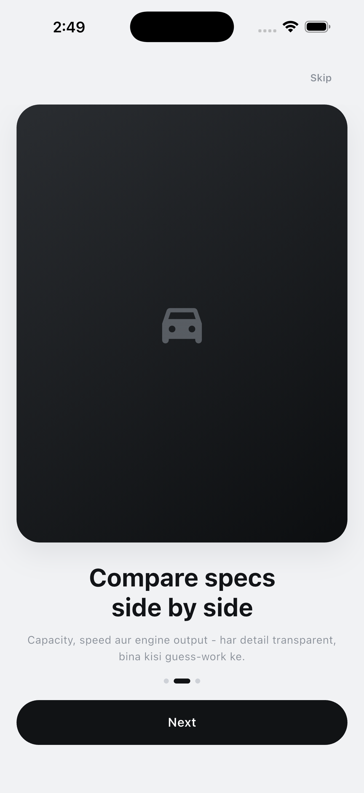
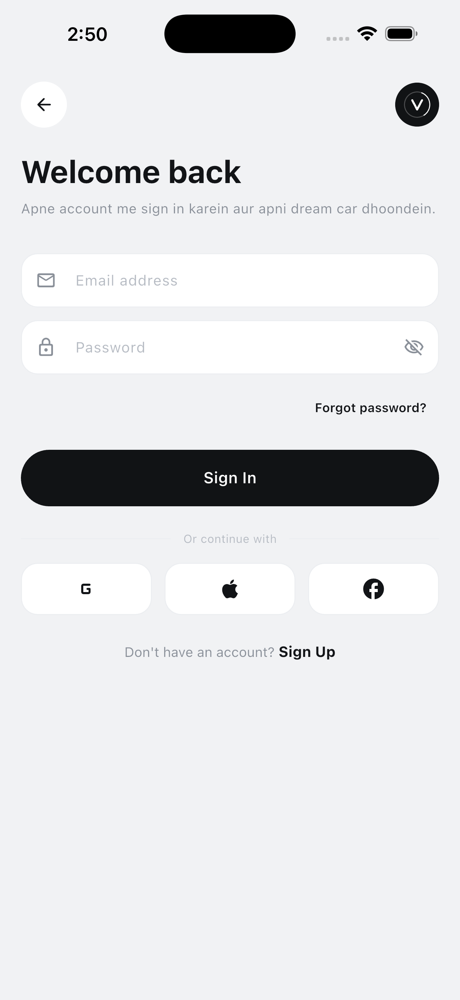
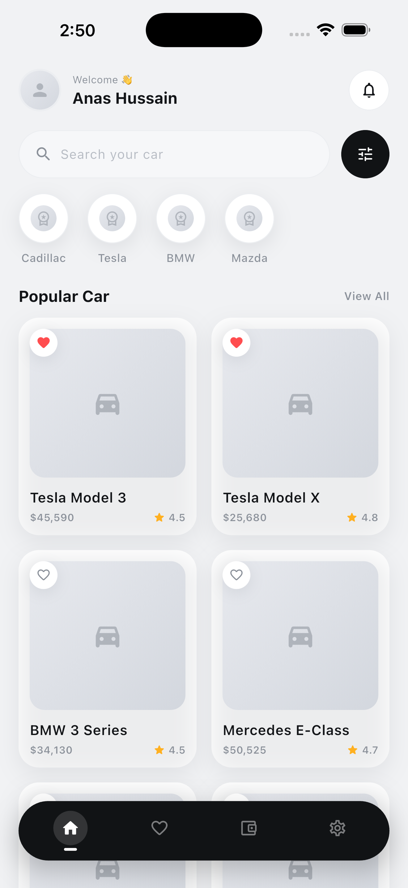
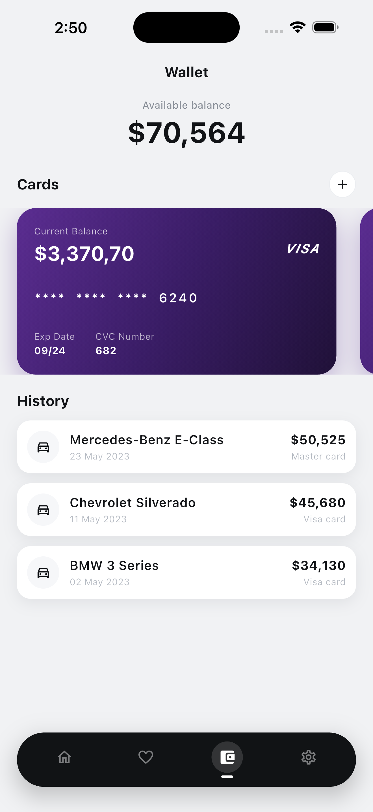
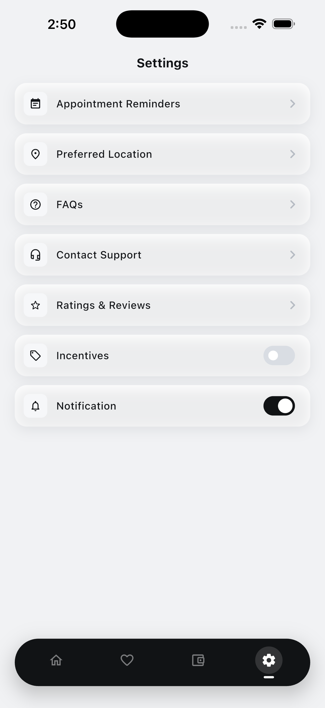

# Velora
# Velora

Premium car marketplace app UI built with Flutter.

## Screenshots

| Onboarding | Home | Car Details |
|:---:|:---:|:---:|
|  |  |  |

| Wallet | Settings |
|:---:|:---:|
|  |  |

## Features
- Onboarding flow with native splash
- Brand filter and car search
- Car details with specs and favorites
- Wallet, transactions and notifications

## Run
```bash
flutter pub get
flutter run
```
